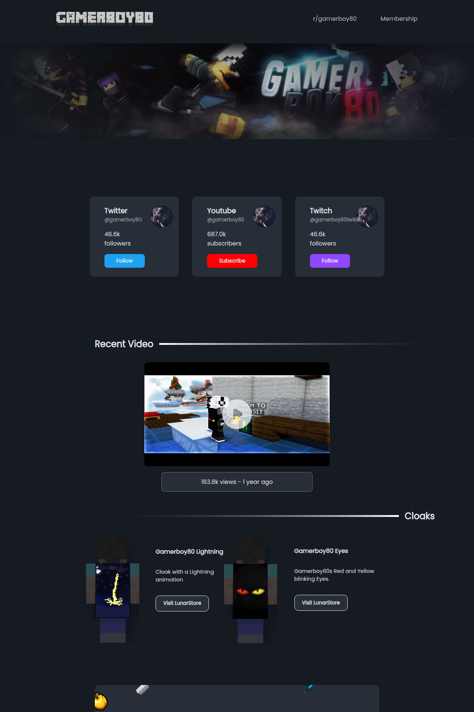

# ibeatkids



ibeatkids.com was a fan site for the minecraft youtuber gamerboy80. it's dead now, so i rebuilt it from the wayback machine (homepage from the 2025-08-14 snapshot, assets from the 2024-03-16 crawl) and stuck a backend behind it so the counters show real numbers instead of whatever the crawler happened to see last. the backend is written in [bend2](https://github.com/bendlang/bend) (2.0.38).

the original frontend js polls a few json endpoints, so the server implements those with the exact response shapes the archived code expects. it only queries the public stuff:

- youtube: the channel rss feed for the latest video, plus a channel page scrape for subs (youtube only shows rounded counts, so 687.0k it is)
- twitch: unauthenticated gql, one query gets followers and live status
- twitter: fxtwitter, because twitter's own endpoints 429 half the internet. it randomly 404s about one time in four so it retries

if an upstream dies you get the last good response (`stale`), and if there's no cache at all it falls back to the archived 2024 data (`seed`). every response carries an `X-Upstream-Status` header telling you which of the three you got. `/api/status` shows the gory details.

## run

you need the `bend` binary (`export PATH="$HOME/.bend/bin:$PATH"`) plus `curl` and `sh`, nothing else. `bend` type-checks everything and runs it on its bundled js runner, no build step.

```sh
bend main.bend
bend main.bend -- -addr 127.0.0.1:16712   # flags go after the --
IBEATKIDS_ADDR=127.0.0.1:16712 bend main.bend
```

flags if you don't like the defaults (a flag beats the env var):

- `-addr` listen address (default `127.0.0.1:16711`, or `$IBEATKIDS_ADDR`)
- `-web` static root (default `web`)
- `-data` where last-good responses get cached (default `data`)

`bend tests/clock.bend` prints the date / number formatting checks.

### how it's put together

```
main.bend           flags, the state loop, routing, the api handlers
src/server.bend     http/1.1 over bend's own tcp, static files with the try_files fallback
src/cache.bend      seed -> disk -> live state per source, last-good on failure, data/*.json
src/upstream.bend   youtube rss + channel page scrape, twitch gql, fxtwitter
src/download.bend   the mediafire resolver behind /download/shortsword
src/fetch.bend      outbound https as background curl jobs
src/json.bend       json parser + serializer
src/clock.bend      rfc3339, http dates, "3 weeks ago", 687.0k, 163,777
src/text.bend       string scanning (no regex engine, so every pattern is a little scanner)
```

it's a handful of computations on bend's event loop: one accepts connections, one owns the cache and spawns a handler per request, and three refreshers each hit their upstream every 5 minutes. bend has tcp but no tls, so https goes through `curl`. on the js runner a child process blocks the whole loop, so curl gets launched detached and the server just polls for its output file. a slow upstream never stalls the site.

## deploy

`deploy/` has a systemd unit and a caddy site block, both with placeholders to fill in. put your user and paths in the unit, point caddy at the listener, reload, done. the unit runs `bend main.bend` from the repo dir. it needs `PATH` to include `~/.bend/bin` and curl. the frontend refetches at most every 5 minutes (the `time` field is now + 5min and the js localStorage-caches off it), so that's the worst case lag on the numbers.

## endpoints

| path | what |
|---|---|
| `GET /api/youtube` | channel info + latest video, the shape `update.js` wants |
| `GET /api/youtube/latestvideo` | same video, flatter shape, `cache_refresh_in: 300000` |
| `GET /api/twitter` | followers for `@gamerboy8O` (that's a zero, the real handle is `gamerboy80`) |
| `GET /api/twitch` | followers for `gamerboy80twitch` |
| `GET /api/twitch/islive` | live status + viewer count, only ever `true` if the data is actually fresh |
| `GET /download/shortsword` | 302 to a freshly resolved mediafire direct link |
| `GET /api/status` | per-upstream diagnostics |
| everything else | static, with `try_files`-style fallback to `index.html` like the original |

## the texture pack situation

the old download button was a bit.ly shortlink to a mediafire page, and mediafire regenerates the direct download token on every page load, so any hardcoded link rots within minutes. instead the button now hits `/download/shortsword`, which scrapes a fresh link off the mediafire page and redirects you to it.

the file itself checks out: 36.74 MB zip, uploaded 2016-08-21 (matches the date on the site), starts with `PK\x03\x04`, and the central directory lists `pack.mcmeta` and the sword textures. it's the real 1.8 short sword pack by TBNRnorton, not some reupload.

## archive quirks

the wayback crawl is imperfect and i kept it authentic on purpose:

- `web/robots.txt` and `web/sitemap.xml` are actually html pages. the origin server served `index.html` for everything back then, and that's what got captured
- the original `/Texturepack` zip was truncated at exactly 1 MiB by the crawler, so it's not hosted (the homepage never linked it directly anyway)
- `web/cape.html` and `web/src.html` still reference dead cloudflare scripts from the original capture

> [!NOTE]
> the site design, frontend and all the assets belong to the original author (reggs per the site footer), not me. i just made it load again.
